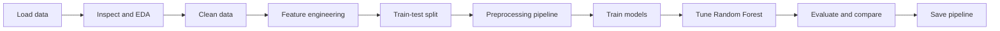

<div align="center">

# 🎓 Predicting Student Mental Health Score from Social Media Usage

**A machine learning regression project that predicts a student's mental health score from their social media habits, study time, sleep, physical activity and stress level.**


</div>

---

## 📑 Table of Contents

- [Overview](#-overview)
- [Repository Files](#-repository-files)
- [Dataset](#-dataset)
- [Workflow](#-workflow)
- [Key Insights from the Data](#-key-insights-from-the-data)
- [Data Preparation Details](#-data-preparation-details)
- [Models and Results](#-models-and-results)
- [Problems Faced and Fixes](#-problems-faced-and-fixes)
- [Tech Stack](#-tech-stack)
- [How to Run](#-how-to-run)
- [Using the Saved Model](#-using-the-saved-model)
- [Limitations](#-limitations)
- [Future Work](#-future-work)
- [What I Learned](#-what-i-learned)
- [Author](#-author)

---

## 🔎 Overview

Students spend a large part of their day on social media. This project asks a simple question:

> **Can a student's mental health score be predicted from their daily habits?**

The target, `Mental_Health_Score`, is a number from about 3 to 10, so this is a **regression** problem. The project covers the full workflow: exploring the data, cleaning it, engineering features, building preprocessing pipelines, comparing models, tuning, evaluating and saving the final pipeline.

### 🏆 Result at a Glance

| Metric | Value |
|--------|-------|
| Final model | Random Forest (default settings) inside a scikit-learn `Pipeline` |
| Test R² | **0.878** |
| Mean absolute error | **0.35** score points |
| Improvement over baseline | R² from 0.740 to 0.878 |

---

## 📁 Repository Files

| File | Description |
|------|-------------|
| `README.md` | This file |
| `Student Social Media And Mental Health Impact.csv` | The dataset (5,000 students, 13 columns) |
| `main_project.ipynb` | The notebook with all the code, from loading data to saving the model |

> Running the notebook creates one more file, `Mental_Health_Model.pkl`, which is the saved pipeline.

---

## 📊 Dataset

**5,000 students, 13 columns, no missing values.**

| Group | Columns | Notes |
|-------|---------|-------|
| 👤 Demographics | `Age`, `Gender`, `Country`, `Academic_Level` | Country has 111 unique values |
| 📱 Platform usage | `Avg_Daily_Usage_Hours`, `Daily_Unlocks`, `Most_Used_Platform`, `Purpose_Of_Use` | Instagram (1,130) and TikTok (918) are most common |
| 🌙 Lifestyle | `Study_Hours`, `Sleep_Hours_Per_Night`, `Physical_Activity_Hours` | Physical activity had a minimum of -0.4 |
| 😰 Stress | `Stress_Level` | Low, Medium, High, Very High |
| 🎯 **Target** | **`Mental_Health_Score`** | Continuous, about 3 to 10 |

---

## 🔄 Workflow



<details>
<summary><b>Click to see all steps in detail</b></summary>

1. **Load and inspect** the data: shape, first rows, missing values, duplicates, data types and summary statistics
2. **Explore** it with six plots: target distribution, correlation heatmap, stress level, usage hours, sleep and platform
3. **Check outliers** with the IQR rule
4. **Clean the data**: remove 2 duplicate rows and clip negative `Physical_Activity_Hours` to 0
5. **Check skewness** and apply a `log1p` transform to `Study_Hours`
6. **Group `Country`** from 111 values to 11 (top 10 plus "Other")
7. **Choose encodings**: ordinal for `Stress_Level`, one-hot for the other categorical columns
8. **Split** the data 70% training and 30% testing, before any preprocessing is fitted
9. **Build the preprocessing** with `ColumnTransformer` and chain it with the model in a `Pipeline`
10. **Train** Linear Regression, a default Random Forest and a tuned Random Forest
11. **Evaluate** with R², MAE and RMSE
12. **Save** the full pipeline with `joblib`

</details>

---

## 💡 Key Insights from the Data

Correlation of each numeric feature with `Mental_Health_Score`:

| Feature | Correlation | Meaning |
|---------|-------------|---------|
| `Avg_Daily_Usage_Hours` | **-0.82** | More daily usage goes with a lower score |
| `Daily_Unlocks` | **-0.79** | More phone unlocks goes with a lower score |
| `Sleep_Hours_Per_Night` | **+0.77** | More sleep goes with a higher score |
| `Study_Hours` | **+0.75** | More study time goes with a higher score |
| `Physical_Activity_Hours` | +0.52 | More activity goes with a higher score |
| `Age` | +0.10 | Almost no relationship |

- The score falls **step by step** as stress level rises from Low to Very High.
- `Avg_Daily_Usage_Hours` and `Daily_Unlocks` are almost the same signal (correlation **0.96**).
- The most used platforms are Instagram, TikTok and Facebook. LINE, VKontakte, KakaoTalk and WeChat each have 50 students or fewer.

---

## 🧹 Data Preparation Details

### Cleaning

| Issue | Evidence | Fix |
|-------|----------|-----|
| Duplicate rows | `df.duplicated().sum()` returned 2 | `drop_duplicates()` |
| Negative physical activity | Minimum of -0.4 hours, 22 IQR outliers | `clip(lower=0)` instead of dropping the rows |

### Feature engineering

`Country` has 111 unique values. One-hot encoding all of them would add over 100 mostly empty columns, and dropping it would lose useful information. So the top 10 countries were kept and the rest were grouped as `Other`, giving 11 categories in a new `Grouped_country` column.

### Preprocessing with `ColumnTransformer`

| Column type | Columns | Treatment |
|-------------|---------|-----------|
| Skewed numeric | `Study_Hours` | `log1p`, then `StandardScaler` |
| Other numeric | `Age`, `Avg_Daily_Usage_Hours`, `Daily_Unlocks`, `Physical_Activity_Hours`, `Sleep_Hours_Per_Night` | `StandardScaler` |
| Ordinal | `Stress_Level` | `OrdinalEncoder` (Low < Medium < High < Very High) |
| Nominal | `Gender`, `Academic_Level`, `Most_Used_Platform`, `Purpose_Of_Use`, `Grouped_country` | `OneHotEncoder` (`handle_unknown='ignore'`) |

Everything is inside a `Pipeline`, so scalers and encoders are fitted on the training data only. This prevents data leakage.

---

## 🤖 Models and Results

Three models were compared on the same 30% test set.

| Model | Test R² | Training R² | MAE | RMSE |
|-------|---------|-------------|-----|------|
| Linear Regression (baseline) | 0.7398 | 0.7237 | 0.5362 | 0.6760 |
| **Random Forest (default)** ⭐ | **0.8776** | 0.9808 | **0.3472** | **0.4637** |
| Random Forest (tuned) | 0.8650 | 0.9547 | 0.3689 | 0.4869 |

### What the results show

- **Random Forest beats the baseline.** Test R² rises from 0.74 to 0.88 and the average error drops from 0.54 to 0.35 score points.
- **Tuning reduced overfitting but did not improve the test score.** The gap between training and test R² shrank from 0.103 to 0.090, yet the default model still scored best on the test set. So the default model is the one saved.

### Tuning setup

`RandomizedSearchCV` with 15 random combinations, 5-fold cross-validation and R² scoring.

| Parameter | Search space | Best value |
|-----------|--------------|------------|
| `n_estimators` | 100, 200, 300 | 200 |
| `max_depth` | 5, 10, 15 | 15 |
| `min_samples_split` | 2, 5, 10 | 5 |
| `min_samples_leaf` | 1, 2, 4 | 2 |

### Metrics explained

| Metric | What it tells you |
|--------|-------------------|
| **R²** | How much of the variation in scores the model explains (0 = useless, 1 = perfect) |
| **MAE** | Average prediction error, in score points |
| **RMSE** | Like MAE, but punishes big mistakes more |

---

## 🛠️ Problems Faced and Fixes

| # | Problem | Fix |
|---|---------|-----|
| 1 | Negative `Physical_Activity_Hours` (minimum -0.4) | Clipped to 0 so the rest of each row was kept |
| 2 | 2 duplicate rows | Removed with `drop_duplicates()` |
| 3 | `Study_Hours` was the most skewed column (0.436) | `log1p` transform plus scaling |
| 4 | `Country` had 111 unique values | Grouped into the top 10 plus `Other` |
| 5 | Ordered and unordered categories need different encoding | Ordinal for `Stress_Level`, one-hot for the rest |
| 6 | Risk of data leakage | Split first, with all preprocessing inside a `Pipeline` |
| 7 | Default Random Forest overfit (training R² 0.98, test R² 0.88) | Tuned with `RandomizedSearchCV`; the gap shrank |
| 8 | Tuning parameters must be prefixed with the step name | Used `random forest__` to match the pipeline step |
| 9 | `Avg_Daily_Usage_Hours` and `Daily_Unlocks` are 0.96 correlated | Kept both and used Random Forest, which handles it well |
| 10 | Saved pickle may not load after a scikit-learn upgrade (1.6.1 to 1.9.0) | Restart the runtime and load with the same version used to train |

---

## 🧰 Tech Stack

| Purpose | Tools |
|---------|-------|
| Language | Python 3 |
| Data handling | NumPy, pandas |
| Visualization | Matplotlib, Seaborn |
| Modelling | scikit-learn (`Pipeline`, `ColumnTransformer`, `LinearRegression`, `RandomForestRegressor`, `RandomizedSearchCV`) |
| Saving the model | joblib |
| Environment | Google Colab / Jupyter Notebook |

---

## ▶️ How to Run

1. **Clone or download** this repository.

   ```bash
   git clone <your-repository-url>
   cd <your-repository-folder>
   ```

2. **Install the requirements.**

   ```bash
   pip install numpy pandas matplotlib seaborn scikit-learn joblib
   ```

3. **Open `main_project.ipynb`** in Jupyter Notebook or Google Colab. In Colab, upload the CSV to the session.
4. **Run the cells from top to bottom.** The order matters because later cells use variables made earlier.
5. The last cells save the trained pipeline as `Mental_Health_Model.pkl`.

> ⚠️ If you run the `pip install --upgrade scikit-learn` cell, restart the runtime afterwards and run everything again.

---

## 🔮 Using the Saved Model

```python
import joblib
import pandas as pd

model = joblib.load('Mental_Health_Model.pkl')

# Raw input: the pipeline does the scaling and encoding itself.
student = pd.DataFrame([{
    'Study_Hours': 3.0,
    'Age': 21,
    'Avg_Daily_Usage_Hours': 5.0,
    'Daily_Unlocks': 170,
    'Physical_Activity_Hours': 1.7,
    'Sleep_Hours_Per_Night': 6.6,
    'Stress_Level': 'Medium',
    'Gender': 'Female',
    'Academic_Level': 'Undergraduate',
    'Most_Used_Platform': 'Instagram',
    'Purpose_Of_Use': 'Social',
    'Grouped_country': 'Other'
}])

print(model.predict(student))
```

> The values above are examples. Use the same column names, and category values that exist in the dataset. Load the model with the same scikit-learn version that was used to train it.

---

## ⚠️ Limitations

- The relationships in the data are very strong and clean, so results may not carry over to real-world data.
- The results show **association, not causation**. The model does not prove that social media use harms mental health.
- The default Random Forest still shows some overfitting (training R² 0.98 against test R² 0.88).
- The model is a learning project and is **not a medical or diagnostic tool**.

---

## 🚀 Future Work

- [ ] Build a **FastAPI** backend with Pydantic validation and a `/predict` endpoint
- [ ] Connect a simple frontend and deploy both parts as a live demo
- [ ] Try **Gradient Boosting** and compare using cross-validation
- [ ] Add **feature importance** to explain which inputs drive predictions
- [ ] Pin the scikit-learn version used for training so the saved model loads reliably

---

## 📚 What I Learned

- How to explore a dataset and spot data quality problems before modelling
- Why different column types need different preprocessing
- How to use `Pipeline` and `ColumnTransformer` to keep preprocessing consistent and avoid data leakage
- How to recognise overfitting from the gap between training and test scores
- That hyperparameter tuning does not always beat the default settings
- Why the whole pipeline, not just the model, should be saved

---

## 👤 Author

**Sanjay Kumar**

---

<div align="center">

⭐ If you found this project useful, consider giving the repository a star.

</div>
